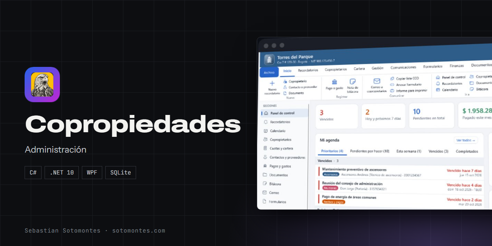
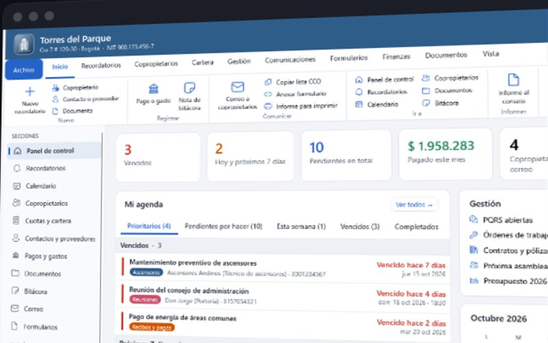
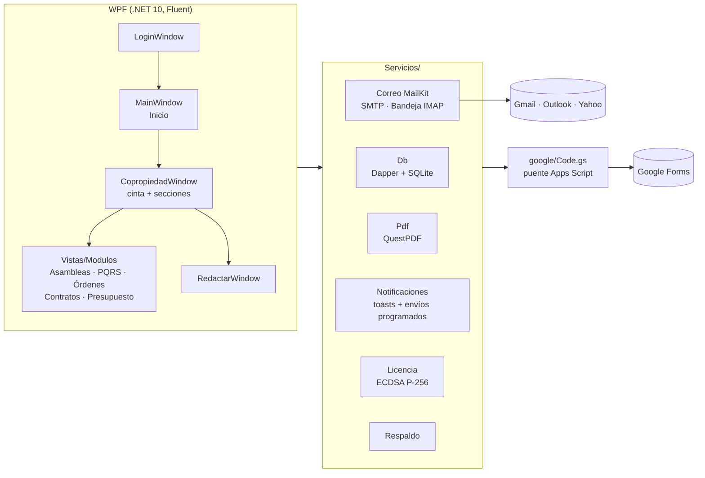

<p align="center"></p>

<p align="center">Administración de conjuntos y edificios: cartera, asambleas, PQRS, contratos, presupuesto y correos masivos.</p>

<p align="center"><a href="https://sotomontes.com/#copropiedades"><b>Ver en sotomontes.com</b></a> · <a href="#cómo-se-usa">Cómo se usa</a> · <a href="#cómo-funciona-por-dentro">Cómo funciona</a> · <a href="#novedades">Novedades</a></p>

| Ficha técnica | |
|---|---|
| **Autor** | Sebastian Sotomontes |
| **Tipo** | Administración |
| **Plataforma** | Windows 10 y 11 |
| **Versión** | 2.4.0 |
| **Estado** | Estable |
| **Stack** | C# · .NET 10 · WPF · SQLite |
| **Código** | Privado. Esta página es solo una presentación. |

---

## Qué es

Copropiedades es un programa de escritorio para administradores de conjuntos residenciales y edificios en Colombia. Concentra el trabajo del día a día, las finanzas, la gestión que exige la Ley 675 de 2001 y las comunicaciones con los residentes, y permite llevar varias copropiedades a la vez.

<p align="center"></p>

## Novedades

- Centro de gestión con indicadores, agenda de hoy y agenda global.
- Copias de seguridad cifradas con verificación y restauración segura.
- Auditoría encadenada, anulación de movimientos y recibos únicos.

## Cómo se usa

1. Crea una copropiedad con sus datos y su estructura de torres y apartamentos.
2. Registra copropietarios, contactos y proveedores. Cada copropiedad se abre en su propia ventana.
3. Revisa **Inicio** cada día: ahí están los recordatorios vencidos, lo prioritario y la agenda.
4. En **Cuotas y cartera** lleva la mora por unidad y emite recibos de caja con el valor en letras. Importa extractos bancarios y compara presupuesto contra ejecutado.
5. Para una asamblea, envía la convocatoria, controla el quórum por coeficientes, registra poderes y votaciones, y genera el acta en PDF.
6. Gestiona **PQRS**, órdenes de trabajo y contratos, y envía correos masivos o formularios de Google a los residentes.

## Funciones

- **Recordatorios** con prioridad, calendario y alertas.
- **Cuotas y cartera**: torres y apartamentos, mora por unidad y recibos de caja.
- **Finanzas**: extractos bancarios, presupuesto contra ejecutado e informe al consejo en PDF.
- **Asambleas**: quórum por coeficientes, poderes, votaciones y acta en PDF.
- **PQRS** con radicado, plazos y respuesta por correo.
- **Órdenes de trabajo, contratos y pólizas** con recordatorio de renovación.
- **Correo masivo** en copia oculta y formularios de Google por copropiedad.

## Detalles

- PQRS con radicado, plazo de 15 días hábiles y respuesta por correo.
- Órdenes de trabajo con fotos, calificación y ranking de proveedores.
- Correo masivo siempre en copia oculta, con plantillas y envío programado.
- Bandeja de entrada por copropiedad.
- Informe mensual al consejo en PDF.
- Usuarios con roles y permisos por copropiedad.
- Copias de seguridad automáticas a Drive u OneDrive.

## Privacidad y seguridad

Incluye autorización y baja de copropietarios según la Ley 1581 de 2012 (habeas data). Las contraseñas de usuario se protegen con Argon2id.

## Cómo funciona por dentro

### Arquitectura



```
CopropiedadesApp/
├── Vistas/        ventanas y módulos (Inicio, Copropiedad, Redactar, Cuentas, Formularios, Modulos/…)
├── Servicios/     Db, Cartera, Gestion, Pdf, Bandeja, Notificaciones, Permisos, Licencia, Respaldo, TextoRico, Avatares, Graficos…
├── Temas/         Claro.xaml, Oscuro.xaml (todos los colores por DynamicResource)
├── google/        Code.gs: puente de Apps Script para Google Forms
├── Ayuda/         guía de usuario (F1) con capturas
└── Instalador/    Inno Setup (Copropiedades.iss, crear_instalador.ps1)
```

---

<sub>© 2026 Sebastian Sotomontes. Todos los derechos reservados.</sub>
